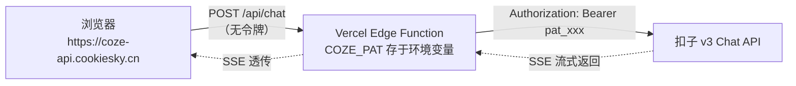

# 初中编程学习小助手 · 部署说明

> 当前部署方式：**Vercel 同时托管聊天页面与代理**（<https://coze-api.cookiesky.cn>）。
> GitHub 仓库仅作代码存储，已关闭 GitHub Pages。
> 令牌只保存在 Vercel 的 Environment Variables（Secret）中，前端代码不含任何密钥。

## 架构



浏览器发出的请求里**永远没有 PAT**，源码、F12、抓包都拿不到。

> ⚠️ **国内网络注意（已实测）**
> `*.workers.dev` 在中国大陆会遭遇 DNS 污染 + SNI 阻断：系统 DNS 返回 `108.160.163.102`，
> 真实 Cloudflare 地址为 `104.21.19.83` / `172.67.185.172`，直连会被重置。
> 面向国内用户时，请选择：
> - **方案 A**：给 Worker 绑定自己的域名（如 `coze-api.cookiesky.cn`）—— 见「自定义域名」一节；
> - **方案 B**：改用 **Deno Deploy**（`*.deno.dev` 目前可访问）—— 见「方案 B」。

## 文件说明

| 文件 | 用途 | 是否可提交到公开仓库 |
|---|---|---|
| `chat.html` | 单文件聊天界面（默认代理模式，不含任何密钥） | ✅ |
| `index.html` | 页面入口（由 `chat.html` 复制），由 Vercel 直接托管 | ✅ |
| `api/chat.js` | Vercel Edge 代理，对应 `POST /api/chat`（流式 SSE） | ✅（不含密钥） |
| `api/health.js` | Vercel 健康检查，对应 `GET /api/health` | ✅ |
| `worker.js` | Cloudflare Worker 代理（国际线路） | ✅（不含密钥） |
| `deno-proxy.ts` | Deno Deploy 代理（国内线路可用） | ✅（不含密钥） |
| `server.js` | Node 代理 + 静态服务（本地调试 / VPS） | ✅ |
| `index.html` + `index.js` | 扣子 Web SDK 演示页，`index.js` 里有 **PAT 明文** | ❌ **禁止提交** |

## 第 0 步：发布智能体

扣子控制台 → 你的智能体 → **发布** → 渠道选择 **Agent as API** → 发布。

没有这一步，接口会返回：

```
[错误 4015] The bot_id ... has not been published to the channel Agent As API.
```

## 第 1 步：部署 Worker（令牌只存在这里）

1. 打开 <https://dash.cloudflare.com> → **Workers & Pages** → **Create** → **Worker**。
2. 把 `worker.js` 的全部内容粘贴进编辑器，点击 **Deploy**。
3. 进入该 Worker → **Settings** → **Variables and Secrets**，添加：

   | 变量名 | 值 | 类型 |
   |---|---|---|
   | `COZE_PAT` | `pat_xxxxxxxx...` | Secret（加密） |
   | `COZE_BOT_ID` | `7694242160769908799` | Text |
   | `ALLOW_ORIGIN` | `https://cookiesky.cn` | Text |

4. 记下 Worker 地址，例如：

```
https://coze-proxy.你的子域.workers.dev
```

5. 浏览器访问 `https://coze-proxy.你的子域.workers.dev/api/health`，
   返回 `{"ok":true,...}` 即部署成功。

> 如果在中国大陆访问该地址超时，属于 DNS 污染，不是配置错误，请使用方案 A 或 B。

## 方案 B：Deno Deploy（国内可直接访问，无需命令行）

1. 打开 <https://dash.deno.com>，用 GitHub 登录 → **New Project / Playground**。
2. 把 `deno-proxy.ts` 的全部内容粘贴进去。
3. 在项目 **Settings → Environment Variables** 添加：

   | 变量名 | 值 |
   |---|---|
   | `COZE_PAT` | `pat_xxxxxxxx...`（设为 Secret） |
   | `COZE_BOT_ID` | `7694242160769908799` |
   | `ALLOW_ORIGIN` | `https://cookiesky.cn` |

4. 点击 **Deploy**，得到地址，例如：

```
https://program-helper.你的用户名.deno.dev
```

5. 自检：浏览器打开 `https://program-helper.你的用户名.deno.dev/api/health`，
   应返回 `{"ok":true,...}`。

## 方案 C：Vercel（免费额度充足，单条 CNAME 即可）

仓库已内置 `api/chat.js`（Edge Function），导入即用。

1. 打开 <https://vercel.com> → **Add New → Project** → Import Git Repository，
   选择 `HG-dev17/Program-helper`。
2. Framework Preset 选 **Other**；Build Command、Output Directory **都留空**。
3. **Environment Variables** 添加（Production 与 Preview 都要）：

   | 变量名 | 值 |
   |---|---|
   | `COZE_PAT` | `pat_xxxxxxxx...`（设为 Secret） |
   | `COZE_BOT_ID` | `7694242160769908799` |
   | `ALLOW_ORIGIN` | `https://coze-api.cookiesky.cn` |

4. 点 **Deploy**，先拿到 `https://program-helper-xxx.vercel.app` 验证 `/api/health`。
5. 项目 → **Settings → Domains → Add**，填 `coze-api.cookiesky.cn`，
   Vercel 会给出 CNAME 目标（通常是 `cname.vercel-dns.com`）。
6. 阿里云 DNS 添加一条记录（不用换 NS）：

   | 类型 | 主机记录 | 记录值 |
   |---|---|---|
   | CNAME | `coze-api` | `cname.vercel-dns.com`（以 Vercel 页面为准） |

7. 等 Vercel 显示 **Valid Configuration**，访问
   `https://coze-api.cookiesky.cn/api/health` 返回 `{"ok":true}` 即完成。

## 第 2 步：让页面指向代理

编辑 `chat.html`（或部署后的 `index.html`）。页面与代理同域，`proxyBase` 保持空字符串：

```js
var CONFIG = {
  mode: "proxy",
  proxyBase: "",   // 同域，请求直接发往 /api/chat
  ...
};
```

> 如果以后把页面放到其他域名，再填代理的完整地址（如 `https://coze-api.cookiesky.cn`）。
> 临时切换代理（不用重新部署）：在网址后加 `?proxy=https://其它代理地址`。

## 第 3 步：访问地址

Vercel 项目同时托管页面与接口，直接访问：

```
https://coze-api.cookiesky.cn/
```

| 用途 | 地址 |
|---|---|
| 聊天页面 | `https://coze-api.cookiesky.cn/` |
| 健康检查 | `https://coze-api.cookiesky.cn/api/health` |
| 聊天接口 | `POST https://coze-api.cookiesky.cn/api/chat` |

> GitHub 仓库仅用于代码托管，GitHub Pages 已关闭，不再发布静态站点。

## 第 4 步：验证

- 页面直接打开即可聊天，不再出现「请配置访问令牌」；
- F12 → Network 里只有发往同域 `/api/chat` 的请求；
- 浏览器控制台、页面源码中搜索 `pat_` 应为 0 结果。

## 自定义域名（DNS）配置

### 方案 A：Cloudflare Worker 绑定 `coze-api.cookiesky.cn`

前提：`cookiesky.cn` 的 DNS 托管在 Cloudflare（当前 NS 为 `dns3/dns4.hichina.com`，需要迁移）。

1. Cloudflare 控制台 → **Add a site** → 输入 `cookiesky.cn` → 选择 Free 计划。
2. Cloudflare 会给出两个 NS，例如 `xxx.ns.cloudflare.com`。
3. 到阿里云域名控制台 → 域名列表 → `cookiesky.cn` → **DNS 修改** →
   把 NS 改成 Cloudflare 给的两个地址，等待生效（几分钟到 24 小时）。
4. **重要**：迁移前先在阿里云导出全部解析记录，迁移后在 Cloudflare 的 DNS 页面逐条重建，
   否则博客会打不开。GitHub Pages 常用记录：

   | 类型 | 名称 | 内容 |
   |---|---|---|
   | A | `@` | `185.199.108.153` |
   | A | `@` | `185.199.109.153` |
   | A | `@` | `185.199.110.153` |
   | A | `@` | `185.199.111.153` |
   | CNAME | `www` | `cookiesky.cn` |

   有邮箱（MX）、验证（TXT）等记录也要一并迁移。
5. 回到 Worker → **Settings → Domains & Routes → Add → Custom Domain**，
   填 `coze-api.cookiesky.cn`，Cloudflare 会自动创建解析并签发证书。
6. 浏览器访问 `https://coze-api.cookiesky.cn/api/health`，返回 `{"ok":true}` 即成功。
7. 把 `index.html` 里的 `proxyBase` 改成 `https://coze-api.cookiesky.cn`。

> 自定义域名只影响一个子域，做好后国内可正常访问，且不受 `workers.dev` 封锁影响。

### 方案 B：只加一条 CNAME（推荐，不迁移 NS）

适用场景：只想给这个页面单独配一条 DNS，不动 `cookiesky.cn` 的 NS。

1. 先在 **Deno Deploy** 项目 → **Settings → Domains → Add Domain**，
   填 `coze-api.cookiesky.cn`。平台会给出 CNAME 目标（通常就是
   `program-helper.你的用户名.deno.dev`）。
2. 登录阿里云 → **云解析 DNS** → `cookiesky.cn` → 解析设置 → **添加记录**：

   | 配置项 | 值 |
   |---|---|
   | 记录类型 | **CNAME** |
   | 主机记录 | `coze-api` |
   | 解析线路 | 默认 |
   | 记录值 | `program-helper.你的用户名.deno.dev`（以 Deno 页面显示为准） |
   | TTL | 600 |

3. 等待 5~10 分钟，回到 Deno 页面点 **Verify / Refresh**，
   状态变为 Active 后会自动签发 HTTPS 证书。
4. 浏览器打开 `https://coze-api.cookiesky.cn/api/health`，
   返回 `{"ok":true}` 即成功。
5. `index.html` 里的 `proxyBase` 已经是该地址，不需要再改。

> 只新增 `coze-api` 这一个子域记录，不要动 `@` / `www`，博客解析不受影响。

## 安全清单

- [ ] **立刻吊销旧令牌**：之前 `chat.html` / `index.js` 里写过 PAT，请到
      扣子 → 个人空间 → 扣子 API → 个人访问令牌，删除旧令牌并重新生成。
- [ ] 新令牌只填入 Vercel 的 Environment Variables（Secret），不再写进任何前端文件。
- [ ] 不要提交 `index.js`（本目录的 `.gitignore` 已忽略它）。
- [ ] `ALLOW_ORIGIN` 限制为页面域名 `https://coze-api.cookiesky.cn`，避免他人网页直接调用你的代理。
- [ ] `COZE_BOT_ID` 已锁定，防止别人拿你的代理调用其他智能体。
- [ ] 如需防刷额度：Vercel 控制台 → Firewall → Rate Limit，
      对 `/api/chat` 设置每 IP 请求上限。
- [ ] 页面是公开站点，任何访问者都能使用你的代理；如面向特定班级，
      可在 `api/chat.js` 中增加简单的口令校验。

## 本地调试

```powershell
# 在项目目录
$env:COZE_PAT="pat_xxx"
$env:COZE_BOT_ID="7694242160769908799"
node server.js
```

然后访问 <http://localhost:3000/chat.html>。

`server.js` 已强制 DNS 优先使用 IPv4，可以绕开部分校园网 IPv6 证书拦截问题。

## 常见错误

| 提示 | 原因 | 处理 |
|---|---|---|
| `错误 4015` | 智能体未发布到 Agent as API | 扣子 → 发布 → 渠道 → Agent as API |
| `错误 401 / 4100` | 令牌无效、过期或无权限 | 重新生成 PAT 并更新 Worker Secret |
| `错误 404`（代理模式） | `proxyBase` 没配或 Worker 路径不对 | 配置 Worker 地址，访问 `/api/health` 自检 |
| `Failed to fetch` | 网络不通 / 校园网 IPv6 证书拦截 / `workers.dev` 被墙 | 换网络；国内请用 Deno Deploy 或自定义域名 |
