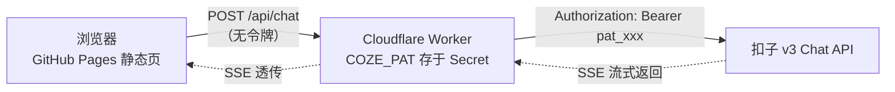

# 初中编程学习小助手 · 部署说明

> GitHub Pages 只能托管静态文件，**无法隐藏任何密钥**。
> 正确做法：页面放在 GitHub Pages，令牌放在 Cloudflare Worker 的 Secret 里。

## 架构



浏览器发出的请求里**永远没有 PAT**，源码、F12、抓包都拿不到。

## 文件说明

| 文件 | 用途 | 是否可提交到公开仓库 |
|---|---|---|
| `chat.html` | 单文件聊天界面（默认代理模式，不含任何密钥） | ✅ |
| `worker.js` | Cloudflare Worker 代理 | ✅（不含密钥） |
| `server.js` | Node 代理 + 静态服务（本地调试 / VPS） | ✅ |
| `index.html` + `index.js` | 扣子 Web SDK 演示页，`index.js` 里有 **PAT 明文** | ❌ **禁止提交** |

## 第 0 步：发布智能体

扣子控制台 → 你的智能体 → **发布** → 渠道选择 **Agent as API** → 发布。

没有这一步，接口会返回：

```
[错误 4015] The bot_id ... has not been published to the channel Agent As API.
```

## 第 1 步：部署 Worker（令牌只存在这里）

1. 打开 <https://dash.cloudflare.com> → **Workers & Pages** → **Create** → **Worker**。
2. 把 `worker.js` 的全部内容粘贴进编辑器，点击 **Deploy**。
3. 进入该 Worker → **Settings** → **Variables and Secrets**，添加：

   | 变量名 | 值 | 类型 |
   |---|---|---|
   | `COZE_PAT` | `pat_xxxxxxxx...` | Secret（加密） |
   | `COZE_BOT_ID` | `7694242160769908799` | Text |
   | `ALLOW_ORIGIN` | `https://你的用户名.github.io` | Text |

4. 记下 Worker 地址，例如：

```
https://coze-proxy.你的子域.workers.dev
```

5. 浏览器访问 `https://coze-proxy.你的子域.workers.dev/api/health`，
   返回 `{"ok":true,...}` 即部署成功。

## 第 2 步：让页面指向 Worker

编辑 `chat.html`（或部署后的 `index.html`），只改一行：

```js
var CONFIG = {
  mode: "proxy",
  proxyBase: "https://coze-proxy.你的子域.workers.dev",   // ← 改这里，末尾不要加 /
  ...
};
```

> 如果是 `server.js` 同域部署，`proxyBase` 保持空字符串即可。

## 第 3 步：上传到 GitHub Pages

1. 新建一个 **public** 仓库（例如 `programming-helper`）。
2. 只上传以下文件：
   - `chat.html` → 重命名为 **`index.html`**
   - 新建一个空文件 **`.nojekyll`**（防止 Jekyll 处理静态资源）
3. 仓库 **Settings** → **Pages** → Source 选 **Deploy from a branch** →
   Branch 选 `main`、目录选 `/(root)` → **Save**。
4. 等待 1~2 分钟，访问：

```
https://你的用户名.github.io/programming-helper/
```

## 第 4 步：验证

- 页面右下角不再出现「请配置访问令牌」，直接可以聊天；
- F12 → Network 里只有发往你自己的 Worker 的 `/api/chat` 请求；
- 浏览器控制台、页面源码中搜索 `pat_` 应为 0 结果。

## 安全清单

- [ ] **立刻吊销旧令牌**：之前 `chat.html` / `index.js` 里写过 PAT，请到
      扣子 → 个人空间 → 扣子 API → 个人访问令牌，删除旧令牌并重新生成。
- [ ] 新令牌只填入 Cloudflare Worker 的 Secret，不再写进任何前端文件。
- [ ] 不要提交 `index.js`（本目录的 `.gitignore` 已忽略它）。
- [ ] `ALLOW_ORIGIN` 限制为你的 Pages 域名，避免他人网页直接调用你的代理。
- [ ] `COZE_BOT_ID` 已锁定，防止别人拿你的 Worker 调用其他智能体。
- [ ] 如需防刷额度：Cloudflare 控制台 → Security → WAF → Rate limiting rules，
      对 `/api/chat` 设置每 IP 每分钟请求上限。
- [ ] GitHub Pages 是公开站点，任何访问者都能使用你的代理；如面向特定班级，
      可在 Worker 中增加简单的口令校验。

## 本地调试

```powershell
# 在项目目录
$env:COZE_PAT="pat_xxx"
$env:COZE_BOT_ID="7694242160769908799"
node server.js
```

然后访问 <http://localhost:3000/chat.html>。

`server.js` 已强制 DNS 优先使用 IPv4，可以绕开部分校园网 IPv6 证书拦截问题。

## 常见错误

| 提示 | 原因 | 处理 |
|---|---|---|
| `错误 4015` | 智能体未发布到 Agent as API | 扣子 → 发布 → 渠道 → Agent as API |
| `错误 401 / 4100` | 令牌无效、过期或无权限 | 重新生成 PAT 并更新 Worker Secret |
| `错误 404`（代理模式） | `proxyBase` 没配或 Worker 路径不对 | 配置 Worker 地址，访问 `/api/health` 自检 |
| `Failed to fetch` | 网络不通 / 校园网 IPv6 证书拦截 | 换网络，或改用 Worker（Cloudflare 出网不受影响） |
